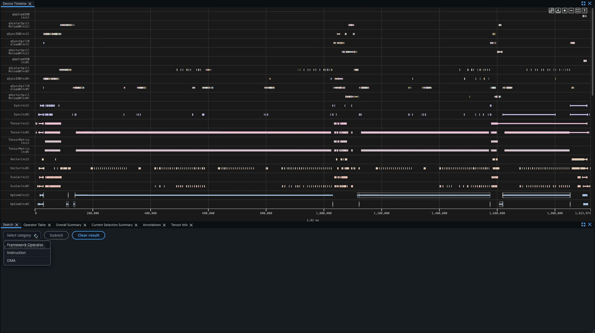

.. meta::
    :description: Learn about Neuron Explorer widgets for device profiling including timeline views, event details, annotations, and performance analysis tools.
    :date-modified: 10/19/2026

Device Trace Viewer
===================

The Neuron Device Trace Viewer displays a hardware instruction level granularity of execution on a NeuronCore. Neuron Explorer collects the timestamped start and end events that occur on the device into a NTFF. As a post-processing step, the profiler will correlate these events with information in the compiled NEFF to generate a detailed report of the hardware performance. The Neuron Explorer UI provides several different tools for an extensible and customizable workflow.

.. image:: /tools/images/device-profile-1.png

Tools
------

Device Trace Viewer
~~~~~~~~~~~~~~~~~~~~~

The Device Trace Viewer presents a timeline view of the device execution, including activity on the DMA and compute engines, Hardware FLOPs Utilization (HFU) and device memory utilization over time, and more.

.. image:: /tools/images/device-profile-2.png

Hover
^^^^^

.. image:: /tools/images/device-profile-3.png

Hover on events in the timeline to see important identifying information at a glance, such as the time window, the hierarchy, and the hardware instruction that was executed.

For more details, clicking the event will display the full details in the Event Details widget.

Color Scheme
^^^^^^^^^^^^

.. list-table::
   :header-rows: 0
   :widths: 50 50

   * - .. image:: /tools/images/device-profile-4.png
          :width: 100%
     - .. image:: /tools/images/device-profile-5.png
          :width: 100%

Instructions are color-coded according to their associated PyTorch operator. All instructions derived from the same PyTorch operator share an identical color.

.. note::
   In future releases, we will introduce more customizable options for color-coding.

Panning
^^^^^^^

.. image:: /tools/images/device-profile-6.gif

Panning is supported in a couple of ways:

* Left-clicking the x-axis and dragging it
* Spinning scroll-wheel while holding down shift
* With the keyboard:
    * A/D keys for left/right movement
    * Left/right arrow keys for left/right movement

The amount panned depends on the current zoom level.

.. _neuron-explorer-instruction-tracks:

Instruction tracks
^^^^^^^^^^^^^^^^^^

Each NeuronCore engine has its own instruction track, labeled with the engine name: ``Vector``, ``Scalar``, ``GpSimd``, and ``Sync``. The Tensor Engine is the exception, with two tracks: ``TensorMatrix`` shows its matrix multiplication (``MATMUL``) instructions, and ``Tensor`` shows all of its other instructions, such as ``LDWEIGHTS`` (weight load). Each event on a track is a hardware instruction that ran on that engine. With LNC=2 (two physical NeuronCores per logical NeuronCore), each physical NeuronCore has its own set of tracks, and the label names it, for example ``Tensor(nc0)``.

.. image:: /tools/images/device-profile-instruction-tracks.png
   :alt: Instruction tracks for each NeuronCore engine with a hover tooltip on a TensorMatrix MATMUL instruction

Each engine's sequencer fetches, decodes, and issues the engine's instructions. To split each engine's track by where its instructions run, turn on **Separate Sequencer and Compute Engine Timelines** in the Device Timeline settings. The sequencer track then shows the control instructions that the sequencer executes itself, such as register arithmetic, branches, and DMA triggers. The compute track shows the data-path instructions that the engine runs on tensors in SBUF and PSUM. ``TensorMatrix`` stays a single compute track. See :ref:`arch_sec_neuron_core_engines` for more about engine sequencers.

.. image:: /tools/images/device-profile-instruction-tracks-sequencer.png
   :alt: The same instruction tracks with Separate Sequencer and Compute Engine Timelines turned on, showing a Sequencer and a Compute track for each engine

Two tracks plot estimated Model FLOPs Utilization (MFU) over time:

* **Estimated Instant MFU** — the MFU at each point in time.
* **Estimated Cumulative MFU** — the MFU from the start of the profile up to each point in time.

The **Estimated Instant HFU** and **Estimated Cumulative HFU** tracks plot Hardware FLOPs Utilization (HFU) the same way. See the :ref:`glossary <neuron-explorer-glossary>` for how MFU and HFU differ.

.. image:: /tools/images/device-profile-mfu-tracks.png
   :alt: Estimated Instant and Cumulative MFU and HFU tracks with a hover tooltip showing utilization

.. _neuron-explorer-dma-tracks:

DMA tracks
^^^^^^^^^^

The DMA tracks show the data each NeuronCore's DMA engines move between HBM and SBUF. By default there is one track per DMA engine, labeled with the engine number, for example ``DMA-E0``, and each event is a single DMA packet. With LNC=2, the label also names the physical NeuronCore, for example ``DMA-E0(nc1)``.

.. image:: /tools/images/device-profile-dma-tracks.png
   :alt: DMA engine tracks DMA-E0 through DMA-E4 with a hover tooltip on a DMA transfer

The **DMA Aggregation** setting in the Device Timeline settings changes how transfers are grouped into tracks:

* **Non-aggregated and group by engine** (default) — one track per DMA engine. Each event is a single DMA packet.
* **Non-aggregated** — one track per DMA queue on each engine. Each event is a single DMA packet.
* **Aggregated** — one track per DMA queue, for example ``qSyncIO0``. Each event is a whole DMA transfer: the set of packets that together move one or more tensors, which can span several engines. The event runs from the first packet's start to the last packet's end. See :ref:`DmaPacketAggregated <profile-schema-dmapacketaggregated>` for how packets are aggregated into transfers.

Queue names come from the compiler and encode the engine that triggers the transfer and its purpose. For example, ``qSyncIO0`` carries input and output transfers triggered from the Sync engine, and ``qVectorSpillReload0`` carries spill and reload traffic triggered from the Vector engine.

Four tracks plot data movement over time:

* **DMA Throughput** — the rate at which the NeuronCore's DMA engines transfer data, to or from HBM and SBUF, at each point in time.
* **Cumulative DMA Throughput** — the total bytes transferred by DMA since the start of the profile, divided by the elapsed time.
* **HBM Throughput** — the rate at which data is read from and written to HBM at each point in time.
* **Cumulative HBM Throughput** — the total bytes read from and written to HBM since the start of the profile, divided by the elapsed time.

.. image:: /tools/images/device-profile-dma-hbm-throughput.png
   :alt: HBM Throughput, Cumulative HBM Throughput, DMA Throughput, and Cumulative DMA Throughput tracks

.. _neuron-explorer-dma-dependencies:

DMA dependencies
^^^^^^^^^^^^^^^^

When you click a device DMA event, the Device Trace Viewer highlights the instructions linked to its transfer. The instruction that started the transfer is highlighted in red. The instructions that depend on the transfer are colored by dependency type, using the dependency legend in the Device Timeline Help.

The instruction that started the transfer depends on how its DMA descriptors are generated (see :doc:`/nki/deep-dives/nki-dge`). With pre-computed descriptors, it is a ``WRITE`` instruction corresponding to a ``PSEUDO_DMA_TRIGGER``. With software DGE or hardware DGE, it is the DMA instruction that issued the transfer, such as ``DMA_DIRECT2D``.

The dependent instructions are the ones that wait for the transfer to finish, on any engine, and the ones that use the transferred data. A waiting instruction is often an ``EVENT_SEMAPHORE``, but any instruction can wait.

Clicking an instruction works the other way: the timeline highlights the DMA transfers linked to it in blue. These links appear only on the timeline, not in the :ref:`Dependencies tab <neuron-explorer-dependency-tab>` of Event Details.

.. _neuron-explorer-host-device-dma:

Host-device DMA tracks
^^^^^^^^^^^^^^^^^^^^^^

Device profiles include a trace of the host-device DMA engines, also known as top-level DMA engines. These engines move data between host memory and device HBM in either direction. They also fetch instructions and carry other traffic that doesn't go through a NeuronCore's own DMA queues, such as model switching and some collective operations. Use these tracks to gauge PCIe traffic, see how collectives use the host-device DMA engines, or debug stalls caused by instruction fetch or model switching.

The **Host-device DMA-E<N>** track shows each transfer on host-device DMA engine *N* as an event, alongside the NeuronCore's compute engine and DMA tracks.

.. image:: /tools/images/device-profile-host-device-dma-trace.png
   :alt: Device Trace Viewer showing a Host-device DMA-E130 track with a hover tooltip for one transfer

Two tracks plot host-device DMA bandwidth over time:

* **Host-Device DMA Throughput** — the transfer rate over the host-device DMA engines at each point in time.
* **Cumulative Host-Device DMA Throughput** — the total bytes transferred since the start of the profile, divided by the elapsed time.

Host-device DMA traffic isn't included in the per-NeuronCore **DMA Throughput** tracks.

.. image:: /tools/images/device-profile-host-device-dma-throughput.png
   :alt: Host-Device DMA Throughput and Cumulative Host-Device DMA Throughput tracks with a hover tooltip showing the transfer rate

Host-device DMA capture is on by default. It requires Neuron Driver 2.31 or later. By default, the Neuron Runtime reserves 64 MB of device memory for each host-device DMA engine it traces. When the buffer is full, the Neuron Runtime drops later host-device DMA events. Adjust the buffer size with ``NEURON_RT_PROFILE_BUF_H2D_DMA_MB``, or set it to ``0`` to turn off host-device DMA capture. See :ref:`Profile buffers <nd-profile-buffers>`.

.. note::

   * Host-device DMA events report transfer sizes but not source or destination addresses. These fields and additional per-event DMA metadata will be available in a future release.
   * On Trn2 and Trn3, each pair of physical NeuronCores shares one host-device DMA engine, and only the even-numbered core of the pair captures its trace. With LNC=2 (two physical NeuronCores per logical NeuronCore), every device profile includes the trace. With LNC=1, only profiles of even-numbered physical NeuronCores include it. On Trn1 and Inf2, each NeuronCore has its own host-device DMA engine, so every device profile includes the trace.

Event Details
~~~~~~~~~~~~~

Upon clicking an event in the Device Trace Viewer, all details related to the event will appear in the Event Details. The information shown will be a superset of the information available on hover, allowing us to dive deeper into what is happening on the hardware.

* The Event Details table will populate with field data from clicked events from the instruction widget.
* When filtering by fields through Search, all matching events will be rendered as pages in the Event Details. Users can navigate through each page to analyze data for each matching event.

.. image:: /tools/images/device-profile-7.png

.. _neuron-explorer-dependency-tab:

Dependency Tab in the Event Details
^^^^^^^^^^^^^^^^^^^^^^^^^^^^^^^^^^^^^

When you click an instruction in the Device Trace Viewer, the **Dependencies** tab of the Event Details lists that instruction's data dependencies, so you can trace how instructions feed into one another without manually cross-referencing program counters (PCs). Dependencies are grouped into two categories based on their direction relative to the selected instruction:

* **Predecessor PCs** — instructions that must complete before the selected instruction can proceed.
* **Successor PCs** — instructions that cannot proceed until the selected instruction completes.

Each dependency is shown as a card with the following fields:

* **PC** — the program counter of the dependency instruction, uniquely identifying it within the profile.
* **Engine** — the hardware engine the dependency instruction runs on (for example, a compute or DMA engine).
* **Dependency type** — a badge naming the kind of dependency edge. Common types include *flow* (true) dependence, where the successor reads a value the predecessor wrote; *anti* dependence, where the successor overwrites a value the predecessor read; and *output* dependence, where both instructions write the same location. A **Bank** badge marks a *Same PSUM Bank* dependency, which Neuron Explorer derives from PSUM bank usage rather than from the compiler; see :ref:`neuron-explorer-same-psum-bank-dependency`. For the underlying ``dependency_type`` field, see the :ref:`Flow table <profile-schema-flow>` in the profile schema reference.

Each card also provides two actions:

* **Copy as JSON** — copies the dependency's fields to the clipboard for use in scripts or bug reports.
* **Navigate to dependency** — jumps directly to the dependency instruction on the timeline and opens its Event Details, letting you follow a dependency chain one instruction at a time.

Use the Dependencies tab to trace dependency chains through a kernel: starting from an instruction of interest, follow its predecessor PCs upstream to find the instructions it waits on, or follow its successor PCs downstream to see what waits on it. This is especially useful for understanding scheduling decisions and locating stalls caused by dependencies between instructions in NKI kernels.

.. image:: /tools/images/device-profile-dependency-pcs.png

.. _neuron-explorer-same-psum-bank-dependency:

Same PSUM Bank dependencies
"""""""""""""""""""""""""""

Two instructions that use the same PSUM bank must run in order, even when the compiler did not record a dependency between them.
For example, a matrix multiplication that starts a new accumulation in a bank cannot overwrite that bank until an instruction on another engine has finished reading the previous result.
Without Same PSUM Bank dependencies, the only way to find this ordering in a profile is to trace the semaphore increments and waits between the engines involved.
A semaphore wait shows that an instruction reading a result out of a PSUM bank waited for the instruction that wrote the result, but no semaphore shows which instruction overwrites that bank next.
Neuron Explorer finds these ordering constraints from the PSUM addresses each instruction accessed and the order in which the instructions ran, and reports each one as a *Same PSUM Bank* dependency.

When you click an instruction that reads or writes PSUM, the Device Trace Viewer highlights the previous and next instructions that used the same PSUM bank, in brown, together with the selected instruction's other dependencies.
The same instructions are listed in the **Dependencies** tab of the Event Details under **Predecessor PCs** and **Successor PCs**, each with a **Bank** badge.
The dependency legend in the Device Timeline Help lists this type as **Same PSUM Bank**.

Neuron Explorer links two instructions with a Same PSUM Bank dependency only when all of the following are true:

* Both instructions used the same PSUM bank on the same NeuronCore, and no other instruction accessed that bank between them.
* At least one of the two instructions wrote the bank. Two instructions that only read the bank are not linked.
* The later instruction does not continue an accumulation that the earlier instruction is part of. Consecutive matrix multiplications that add into the same accumulation are not linked to each other.

The **Bank** badge does not show which bank the two instructions share.
To see the bank, compare the symbolic operands of the two instructions, shown as **Symbolic Operands** in the hover and as ``symbolic_operands`` in the Event Details.
These give each PSUM operand's location, for example ``PSUM(partition=0,bank=6,offset=0)``.
For programmatic analysis, the ``psum_read_banks`` and ``psum_write_banks`` fields of the ``Instruction`` table list the banks each instruction reads and writes, and Same PSUM Bank edges are stored in the ``Flow`` table with a ``dependency_type`` of ``SAME_PSUM_BANK``.

.. note::
   An instruction pair can have both a Same PSUM Bank dependency and a dependency recorded by the compiler, such as a flow dependence.
   For such a pair, the timeline highlight and the Dependencies tab show only one of the two dependency types.

.. _neuron-explorer-search:

Search
~~~~~~

The Search widget allows you to find events in the Device Trace Viewer by filtering on field values. Search results are displayed directly within the Search widget with pagination controls for navigating through matches.

Using Search
^^^^^^^^^^^^

1. The Search widget is available at the bottom left corner of the page. If it is not visible, click the **Add Widget** button and select **Search** to add it.
2. Select a category (**Framework Operator**, **Instruction**, or **DMA**), then select a field name and enter a search value. The search supports exact match and partial match filtering.
3. Click **Submit**. The Search Results Table populates with matched events.

Search Results Table
^^^^^^^^^^^^^^^^^^^^

Use the pagination controls (previous/next) in the Search Results Table to step through matching events.

* Matching events are highlighted in a yellow border.
* To focus the Device Trace Viewer on the current event, click the **Focus** button in the Search Results Table. The Device Trace Viewer pans and scrolls to bring that event into view.
* The currently focused event in the Device Trace Viewer is highlighted in a cyan border, and corresponds with the current paged event in the Search Results Table.

**Clearing Results**: Click **Clear result** in the Search widget to clear the Search Results Table and remove search highlights from the Device Trace Viewer.

Annotations
~~~~~~~~~~~

Users can create annotations by right-clicking in the Device Trace Viewer. These annotations can be moved by clicking and dragging the vertical line, and will snap to the closest events when applicable.

The annotations tab will show more details on all available annotations in the profile, such as the time difference and summary metrics that occur between two markers. The option of which two annotations to compare is configurable in the diff vs column. You can also quickly zoom in to the region between two annotations by selecting the checkbox on the left. Users can rename, delete, save, and load annotations for better readability and collaboration.

In addition to annotations, you can enable NKI Regions using ``nki.language.profiler_region_open`` and ``nki.language.profiler_region_close``. These appear automatically in the Region Highlighter panel when viewing a profile of an annotated kernel.

.. image:: /tools/images/device-profile-8.png

Automatic timeline warnings
~~~~~~~~~~~~~~~~~~~~~~~~~~~~

In addition to the annotations you create yourself, Neuron Explorer automatically highlights regions of the device timeline that exhibit known performance anti-patterns. These appear as colored bands spanning the flagged time range. Hover over a band to see its name, time range, duration, and a **Details** message describing the issue and suggested fix.

.. _neuron-explorer-small-dma-warning:

Small DMA transfers warning
^^^^^^^^^^^^^^^^^^^^^^^^^^^^

Neuron Explorer automatically flags regions dominated by very small hardware-dynamic DMA transfers generated by the Descriptor Generation Engine (DGE). Small DGE DMAs are a common source of DMA inefficiency: they carry little data per transfer yet still consume DMA issue slots and HBM bandwidth, which can back-pressure HBM and make instruction timing in the region unreliable.

The warning appears as an amber band labeled **Small DMA transfers** on the timeline. Hovering over the band shows a **Details** message such as:

   *Excessive small DMA transfers (N instructions) back-pressure HBM in this region, making instruction timing here unreliable. Consider batching or vectorizing these transfers.*

where *N* is the number of small DMA instructions in the flagged window.

**Recommended action.** Batch or vectorize the small transfers so each DMA moves more data per descriptor. Larger, coalesced transfers use HBM bandwidth far more efficiently. Aim for contiguous payloads of at least 4 KiB per transfer; see the :ref:`nki-dma-bandwidth-guide` for why large payloads are required to saturate HBM bandwidth. See ``average_dma_size`` in the :doc:`Summary Viewer <overview-summary-page>` for a profile-wide view of transfer sizes.

Operator Table
~~~~~~~~~~~~~~

The Operator Table aggregates the hardware level metrics into framework layers and operations, such as the MFU and amount of data being moved. Users can progressively expand each row to get a further breakdown of each nested operator.

Filters can be applied and columns can be sorted for more streamlined viewing.

.. image:: /tools/images/device-profile-9.png

Overall Summary
~~~~~~~~~~~~~~~

The Overall Summary displays performance metrics across the entire profile run, with metrics broken down into different categories such as by the NeuronCore engines. These can be used for quick insights into how well the model performed.

.. image:: /tools/images/device-profile-10.png

Current Selection Summary
~~~~~~~~~~~~~~~~~~~~~~~~~

The Current Selection Summary provides metrics for the current time window. Zooming in and out in the Device Trace Viewer will update the summary. This can be used in conjunction with the zoom feature of Annotations for easy access to a region of interest.

.. image:: /tools/images/device-profile-11.png

.. _box-selection-summary:

Box Selection Summary
~~~~~~~~~~~~~~~~~~~~~

The Box Selection Summary provides metrics within a bounding box region. Select and drag regions within the timeline widget to update the summary.

.. image:: /tools/images/box-select.gif

Box selection is supported in a couple of ways:

* Toggling the box selection button within the timeline widget
* Clear selection with `esc` key

Corresponding summary information of the selected region is displayed within the box selection widget.

Export to CSV
~~~~~~~~~~~~~

The **Export to CSV** button in the timeline toolbar exports the events in the visible time range, one CSV file per event table. Zoom to select that range.

See :ref:`Export timeline events to CSV <neuron-explorer-export-timeline-csv>` for the full procedure and the available tables.

Code Viewer
~~~~~~~~~~~

Profiles that are uploaded with source code files (added in the **Source Code** section of the upload dialog, or passed with ``--framework-source-root`` / ``--nki-source-root`` on the CLI) enable users to quickly navigate between NKI and application level source code and the corresponding hardware level instructions.

In the Device Trace Viewer, we can click on an event to highlight the source code line in the Code Viewer. Cmd+click (macOS) or Ctrl+click (Windows/Linux) on the event will scroll to the corresponding source code line.

In the Code Viewer, clicking on a line in the source code will automatically highlight all associated events in the Device Trace Viewer. Similarly, highlighting multiple lines of the source code will also highlight all events in the timeline.

.. image:: /tools/images/device-profile-12.png

See :ref:`neuron-explorer-source-code` for instructions on how to enable source code viewing.

Layout Customization
~~~~~~~~~~~~~~~~~~~~

Understanding and optimizing performance with the profiler can be overwhelming given the amount of information being processed and displayed. As part of preparing for optimization work, you can cross-reference different information, such as the Device Trace Viewer with the application source code. With the widget-based UI, you can customize the layout to best fit a specific workflow. Each widget can be added, removed, dragged around, and resized. Once you are happy with the layout, you can save it through the Layout dropdown at the top right. The layouts are not tied to a specific profile, so they can be loaded and re-used for future profiles as well.

.. image:: /tools/images/device-profile-13.png

.. _profile-comparison:

Profile Comparison (beta)
~~~~~~~~~~~~~~~~~~~~~~~~~

.. note::

   Profile Comparison is a beta feature in this release. The interface and
   behavior might change in future releases based on user feedback.

Profile Comparison lets you view two or more device profiles side by side to identify performance differences between runs — for example, before and after an optimization, across different compiler flags, or between model variants.

.. image:: /tools/images/device-profile-comparison.png

How to compare profiles
^^^^^^^^^^^^^^^^^^^^^^^

Ensure you have two or more processed device profiles in the Profile Manager before starting.

1. In the **Profile Manager**, select two or more device profiles using the checkboxes.
2. Click **Actions** → **Compare profiles**. Neuron Explorer opens the comparison view with each profile's device timeline stacked vertically and comparison widgets below.

To return to single-profile view, navigate back to the Profile Manager.

Comparison view layout
^^^^^^^^^^^^^^^^^^^^^^

The comparison view contains:

* **Stacked timelines** — One device timeline per profile, arranged vertically for visual comparison of execution patterns.
* **Compare Operator Table** — Aggregates operator-level metrics (execution time, FLOPs) across profiles with inline deltas showing improvement or regression.
* **Compare Overall Summary** — Compares high-level metrics such as engine utilization, throttle counts, and opcode breakdown.
* **Compare Current Selection Summary** — Compares metrics for the currently zoomed time range across all profiles.

In comparison tables, select a **base profile** using the dropdown. All other profiles display delta values relative to the base, so you can see which operations improved or regressed.

Global zoom modes keep timelines aligned:

* **Global relative zoom** — Zoom in and out proportionally to all timelines.
* **Global absolute zoom** — Zoom to an exact nanosecond range across all timelines.
* **Synchronized time range** — Set a specific start and end time (absolute or percentage) to all timelines simultaneously.
